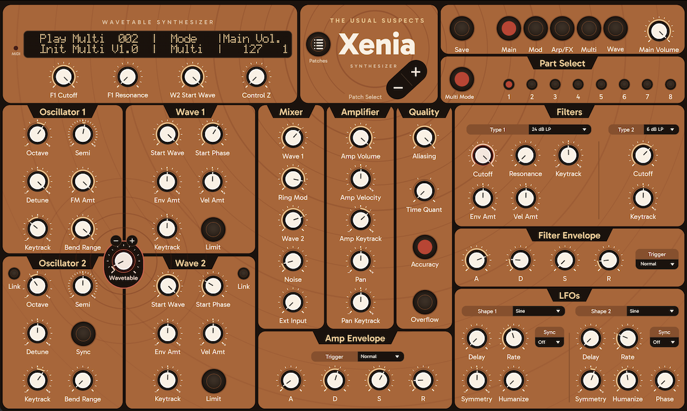
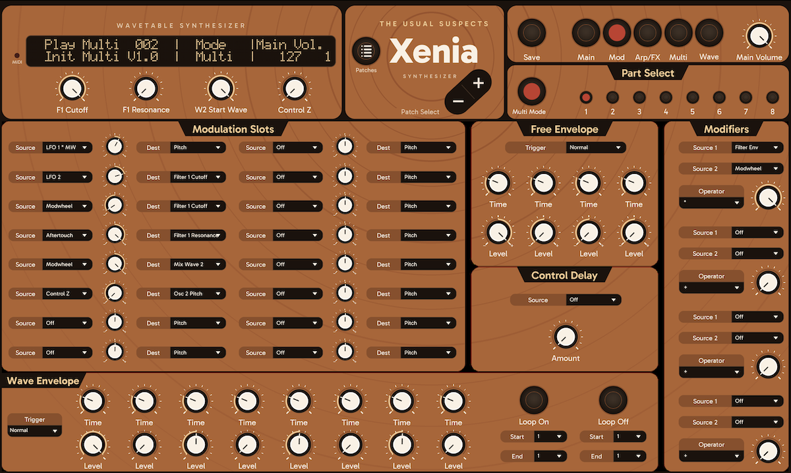
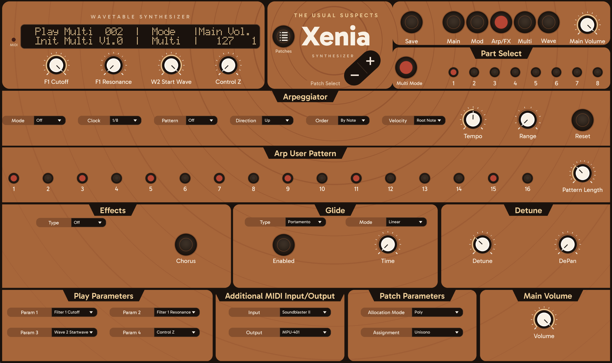
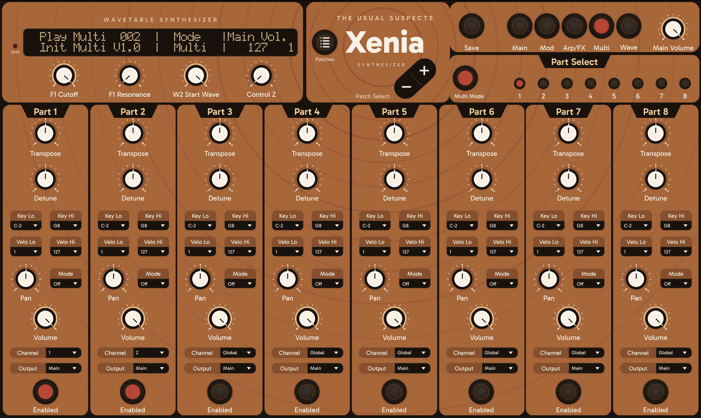
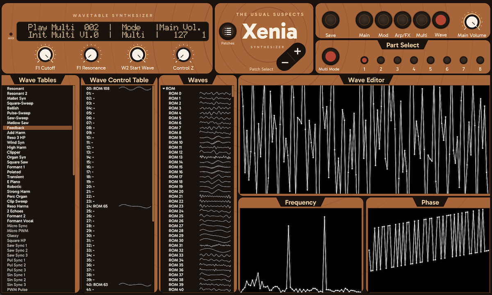
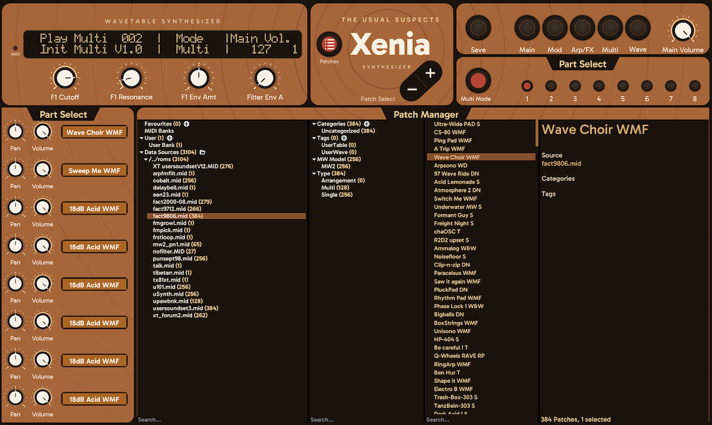

# Simpless — Skins for The Ususal Suspects VST Synthesizers

---

**Simples** is a skins for vst the **The Usual Suspects** synthesizers (Xenia and others) style.

Design: soft rounded panels on dark background, muted copper-orange accents (Xenia hardware tone), cream text, red accent.
Created with love for audio interfaces and open-source culture.

---

## 🎹 For Musicians

Simples was created by a musician and software developer who values:
- **Clean UI** — nothing extra, everything in its place
- **Dark theme** — comfortable for night sessions
- **Gabarito font** (SIL OFL) — readability and style
- **Full compatibility** with the synthesizer's default skin

The skin changes the look of the interface, but keeps all functionality intact.

---

## 📦 Installation

1. Download the archive `Simples-<synth>-<version>.zip`
2. Unzip — you get the folder **Simples/**
3. Place it in the synthesizer's skins directory:
   - **Windows**: `%APPDATA%\The Usual Suspects\<synth>\skins\`
   - **macOS**: `~/Library/Application Support/The Usual Suspects/<synth>/skins/`
     *(or sometimes `~/Documents/The Usual Suspects/<synth>/skins/`)`
4. Select **Simples** in the skin menu

---

## 📸 Screenshots

  

  

_Screenshots for Xenia skin (v0.1.0). More screenshots per synth in `release/<synth>/screenshots/`._

---

## 💖 Support

If you like this work, you can support the developer:

---

## 👤 Author

**Vitalii Zenkov (KYOTO)** — full-stack developer and musician.

-  https://github.com/vitzen
-  https://t.me/kyotosound
-  https://www.facebook.com/kyotosound/
-  https://soundcloud.com/kyotosound
-  https://www.mixcloud.com/kyotosound/
-  https://www.youtube.com/@vitalii_kyoto
-  kyotochillout@gmail.com